# SOLID Principles

## Intro

SOLID is a set of five object-oriented design principles that make code easier to understand, extend, and maintain.

| Letter | Principle | In one line |
|--------|-----------|-------------|
| **S** | Single Responsibility Principle (SRP) | Each class should be responsible for a single part or functionality of the system. |
| **O** | Open Closed Principle (OCP) | Software components should be open for extension but closed for modification. |
| **L** | Liskov Substitution Principle (LSP) | Objects of a superclass should be replaceable with objects of its subclasses without breaking the system. |
| **I** | Interface Segregation Principle (ISP) | Prefer fine-grained, client-specific interfaces over one large general-purpose interface. |
| **D** | Dependency Inversion Principle (DIP) | High-level modules should not depend on low-level modules; both should depend on abstractions, not concretions. |

## Single Responsibility Principle (SRP)

When programmers need to add features or new behavior, they frequently integrate everything within the current class. When something needs to be changed later, the complexity of the code makes the update time-consuming and tedious.

SRP helps us create simple classes that perform just one task. This makes modifying or extending the existing code much easier.

### Example: book invoice application

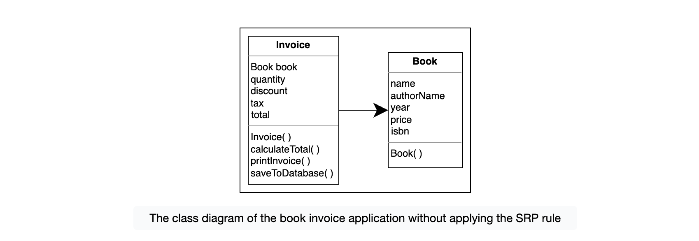

- `Book` is fine: it only contains data related to a book.
- `Invoice` breaks the rule: besides calculating the total, it also has the printing method (`printInvoice()`) and the storage method (`saveToDatabase()`). Printing and storage are separate responsibilities and should go into separate classes.

### Correct way

Move printing and storage out of `Invoice` into their own classes, so each class has one responsibility.

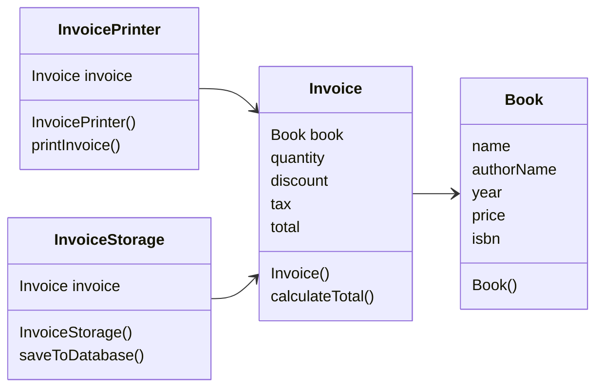

| Class | Single responsibility |
|-------|-----------------------|
| `Book` | Holds book data |
| `Invoice` | Calculates the invoice total |
| `InvoicePrinter` | Prints the invoice |
| `InvoiceStorage` | Saves the invoice to the database |

## Open Closed Principle (OCP)

> "A software artifact should be open for extension but closed for modification."

A system should improve easily by adding new code instead of changing the core code. This way, the core code always retains its unique identity, making it reusable.

### Example: volume calculator

Suppose we design a class that calculates the volume of shapes.

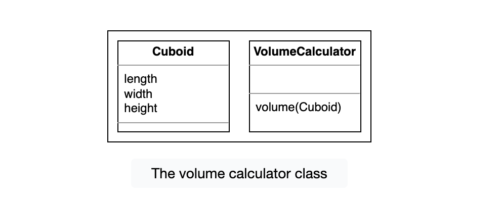

- `VolumeCalculator` only knows about `Cuboid`: `volume(Cuboid)`.
- When we add new shapes such as `Cylinder` and `Cone`, the existing `VolumeCalculator` has to be changed every time, and it fills up with `if` checks for each shape type.

### Correct way

Create an abstract class `Shape` that declares `volume()`. Each shape extends `Shape` and provides its own `volume()`. A new shape is added by writing a new subclass, without breaking or modifying the existing code.

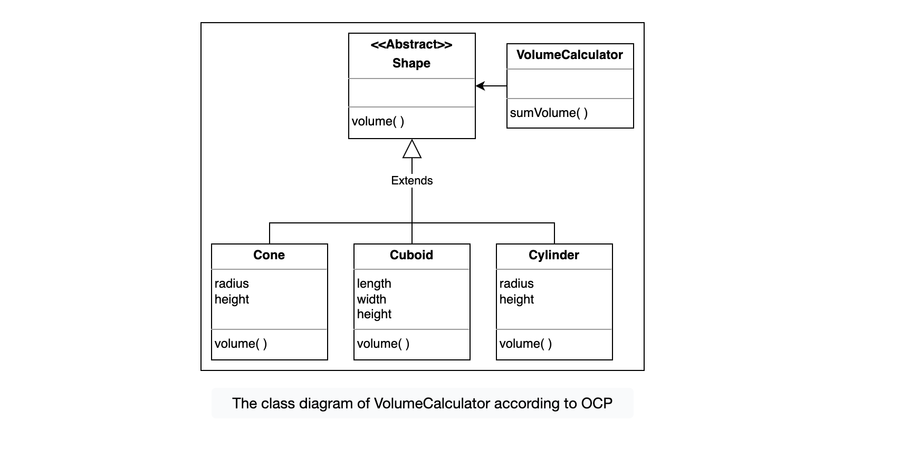

| Class | Role |
|-------|------|
| `Shape` (abstract) | Declares `volume()` |
| `Cone`, `Cuboid`, `Cylinder` | Extend `Shape`, each implements its own `volume()` |
| `VolumeCalculator` | `sumVolume()` works on `Shape`, so it never changes when a shape is added |

## Liskov Substitution Principle (LSP)

LSP guides the use of inheritance so that the application does not break. Objects of a subclass should behave the same way as objects of the superclass, so that they are replaceable. The rule applies to abstraction concepts like inheritance and polymorphism.

**Simple test:** any code written for the parent must keep working when it is handed a child instead. If a child cannot honestly do something the parent promises, it should not be a child of that parent.

### Example: vehicles

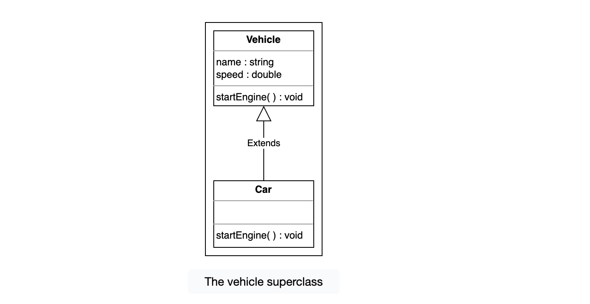

`Vehicle` promises `startEngine()`. `Car` is fine: it has an engine, so a `Car` can be used anywhere a `Vehicle` is expected.

Now add `Bicycle extends Vehicle`. A bicycle has no engine, so its `startEngine()` can only do nothing or throw an error:

```java
class Bicycle extends Vehicle {
    @Override
    void startEngine() {
        throw new UnsupportedOperationException("A bicycle has no engine");
    }
}

// Written for the parent type; knows nothing about bicycles.
void startAll(List<Vehicle> vehicles) {
    for (Vehicle v : vehicles) {
        v.startEngine();   // works for Car, crashes for Bicycle
    }
}
```

`startAll` was correct before `Bicycle` existed, and nobody changed it, yet it now breaks. A `Bicycle` cannot replace a `Vehicle`, so the inheritance is wrong. That is the LSP violation.

The cause is that the parent promised too much: `startEngine()` is not true for *every* vehicle.

### Correct way

Keep in `Vehicle` only what is true for all vehicles (`name`, `speed`). Split the subtypes into `Motorized` and `Manual`, and extend those.

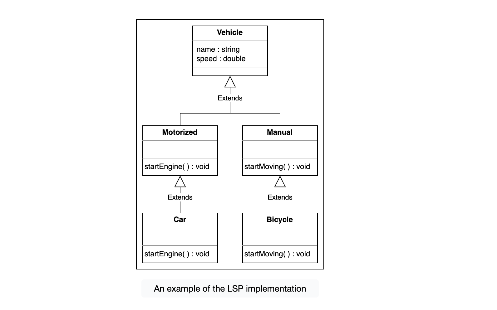

| Class | Promises | Children |
|-------|----------|----------|
| `Vehicle` | Only `name` and `speed` | `Motorized`, `Manual` |
| `Motorized` | `startEngine()` | `Car` |
| `Manual` | `startMoving()` | `Bicycle` |

Now every substitution is safe:

- Code that needs an engine asks for `Motorized`. A `Bicycle` can never be passed in, so it cannot crash.
- A `Car` can replace a `Motorized`, and a `Bicycle` can replace a `Manual`.
- Both can replace a `Vehicle`, because `Vehicle` no longer promises anything a bicycle cannot do.

## Interface Segregation Principle (ISP)

An interface should not contain methods that its implementers do not use or need. ISP goes against fat interfaces and prefers small interfaces, each with a group of methods serving one particular purpose.

**Simple test:** if a class is forced to implement a method it has no real use for, the interface is too fat.

### Example: the Shape interface

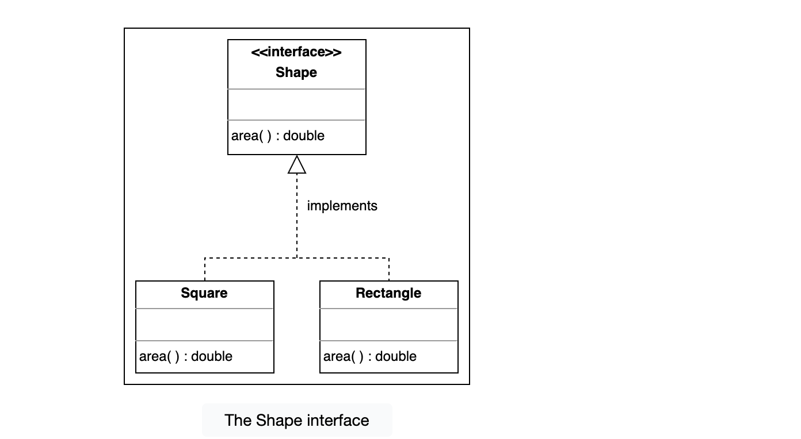

So far this is right: `Square` and `Rectangle` both implement an interface whose only method, `area()`, they actually use.

### Violation

Add `volume()` to the `Shape` interface and a new class `Cube` to implement it.

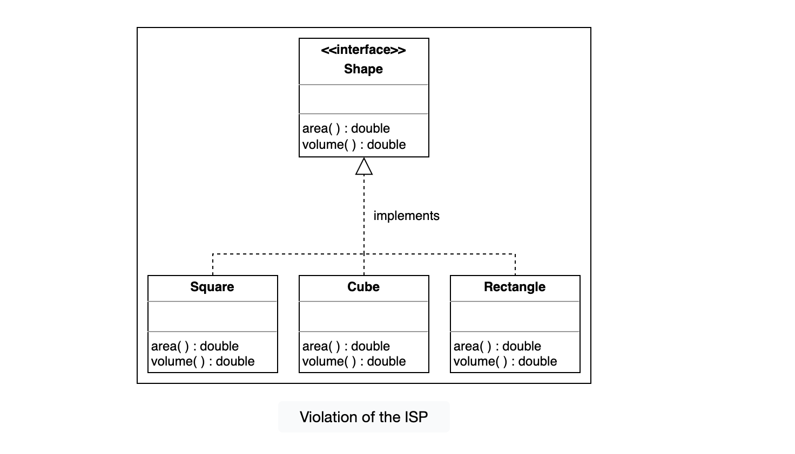

- Every class implementing `Shape` must now implement `volume()` too.
- `Square` and `Rectangle` are 2D: `volume()` is not used or needed by them, but they are forced to provide it.
- `Shape` has become a general-purpose (fat) interface. This violates ISP.

### Solution

Make the interfaces client-specific rather than general-purpose. Split `Shape` into two distinct interfaces: `TwoDimensionalShape` for 2D shapes and `ThreeDimensionalShape` for 3D shapes.

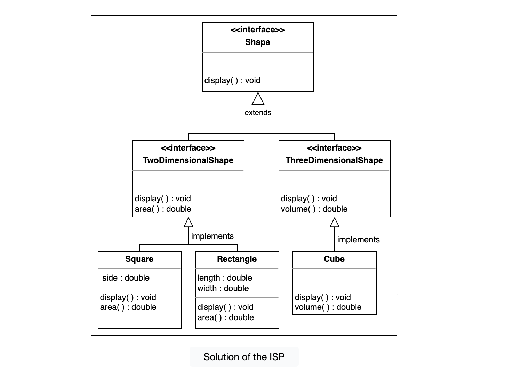

| Interface | Methods | Implemented by |
|-----------|---------|----------------|
| `Shape` | `display()` (common to all shapes) | — |
| `TwoDimensionalShape` | `display()`, `area()` | `Square`, `Rectangle` |
| `ThreeDimensionalShape` | `display()`, `volume()` | `Cube` |

Now each class implements only the methods it needs.

### ISP vs LSP

The same mistake (`Square` having `volume()`) shows up under both principles, seen from two sides:

- **ISP** looks at the interface: it is too fat, so implementers are forced to write methods they do not need.
- **LSP** looks at the caller: code that trusts `Shape.volume()` breaks when it is handed a `Square`.

Splitting the interface fixes both.

## Dependency Inversion Principle (DIP)

High-level modules should not depend on low-level modules; both should depend on abstractions. Abstractions should not depend on details; details should depend on abstractions.

- **High-level module:** the class holding the business logic (*what* the app does), e.g. `InvoiceService`.
- **Low-level module:** the class doing the technical detail (*how* it is done), e.g. `MySqlDatabase`.
- **Abstraction:** an interface between the two, e.g. `InvoiceStorage`.

**Simple test:** if a business class contains `new SomeConcreteClass()` for its helper, it depends on a detail. It should receive an interface instead.

### Example: saving an invoice

Without DIP, the high-level class creates and uses the low-level class directly:

```java
class MySqlDatabase {
    void save(Invoice invoice) { /* MySQL code */ }
}

class InvoiceService {
    private MySqlDatabase database = new MySqlDatabase();   // depends on a detail

    void checkout(Invoice invoice) {
        invoice.calculateTotal();
        database.save(invoice);
    }
}
```

Dependency: `InvoiceService → MySqlDatabase`

- Switching to MongoDB or a file means editing `InvoiceService`, even though the business logic did not change.
- `InvoiceService` cannot be tested without a real MySQL database.

### Correct way

Put an interface in between. The high-level class uses the interface, and the low-level classes implement it.

```java
interface InvoiceStorage {
    void save(Invoice invoice);
}

class MySqlStorage implements InvoiceStorage {
    public void save(Invoice invoice) { /* MySQL code */ }
}

class FileStorage implements InvoiceStorage {
    public void save(Invoice invoice) { /* file code */ }
}

class InvoiceService {
    private final InvoiceStorage storage;

    InvoiceService(InvoiceStorage storage) {   // receives it from outside
        this.storage = storage;
    }

    void checkout(Invoice invoice) {
        invoice.calculateTotal();
        storage.save(invoice);
    }
}

// The choice is made in one place, outside the business logic:
InvoiceService service = new InvoiceService(new MySqlStorage());
```

Dependencies: `InvoiceService → InvoiceStorage ← MySqlStorage, FileStorage`

- `InvoiceService` knows only the interface. Adding `MongoStorage` is a new class; `InvoiceService` is not touched.
- Tests can pass in a fake storage.

### Why "inversion"?

Before, the arrow pointed from the business logic down to the detail (`InvoiceService → MySqlDatabase`). After, the detail's arrow points up to the abstraction (`MySqlStorage → InvoiceStorage`). The low-level class now depends on something the high-level side defines, so the direction of the dependency is inverted.

Passing the dependency in through the constructor is called **dependency injection**; it is the usual way to apply DIP.

### Example 2: high school

Same idea with a school. `Headmaster` is the high-level class (it manages the staff). `Teacher`, `Assistant` and `Helper` are the low-level classes (the specific kinds of staff).

**Violation**

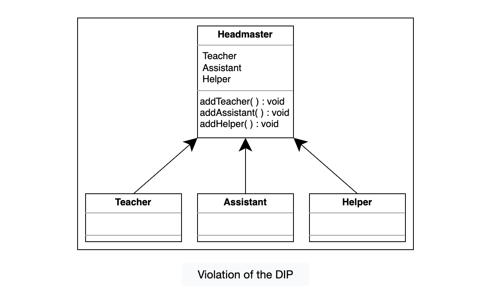

`Headmaster` names every concrete class: it has a `Teacher` field, an `Assistant` field, a `Helper` field, and one method for each.

```java
class Headmaster {
    void addTeacher(Teacher t)     { ... }
    void addAssistant(Assistant a) { ... }
    void addHelper(Helper h)       { ... }
}
```

To add a `Secretary`, we must open `Headmaster` and add a new field and an `addSecretary()` method. Every new staff type means editing the high-level class.

> The arrows in this diagram are drawn from the staff classes to `Headmaster`, but the dependency actually runs the other way: `Headmaster` is the one that knows about and depends on `Teacher`, `Assistant` and `Helper`.

**Solution**

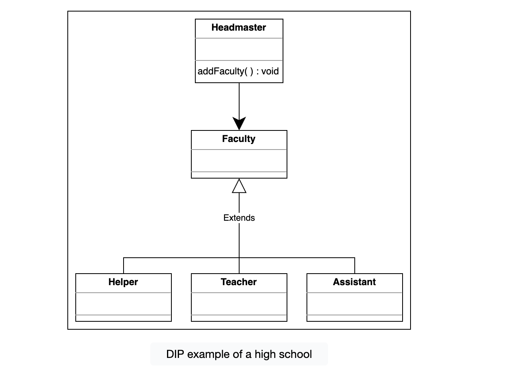

Introduce the abstraction `Faculty`. `Headmaster` knows only `Faculty`; the staff classes extend it.

```java
class Headmaster {
    void addFaculty(Faculty f) { ... }   // works for any kind of faculty
}

class Teacher   extends Faculty { }
class Assistant extends Faculty { }
class Helper    extends Faculty { }
```

`Headmaster` no longer mentions `Teacher`, `Assistant` or `Helper` anywhere.

**Adding a new class**

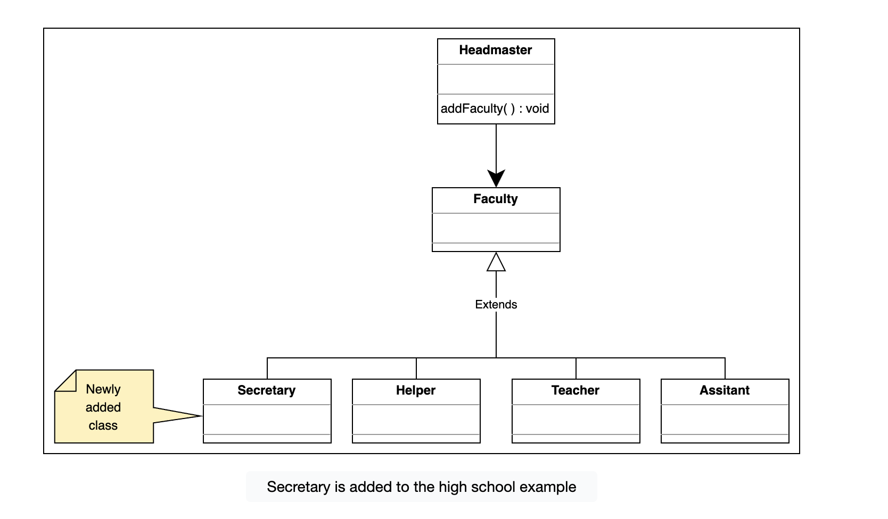

`Secretary extends Faculty` is one new class. `Headmaster` is not touched: `addFaculty()` already accepts it.

| | Without DIP | With DIP |
|---|-------------|----------|
| `Headmaster` knows | `Teacher`, `Assistant`, `Helper` | Only `Faculty` |
| Methods | One per staff type | One `addFaculty()` |
| Adding `Secretary` | Edit `Headmaster` | Add one class, `Headmaster` unchanged |
