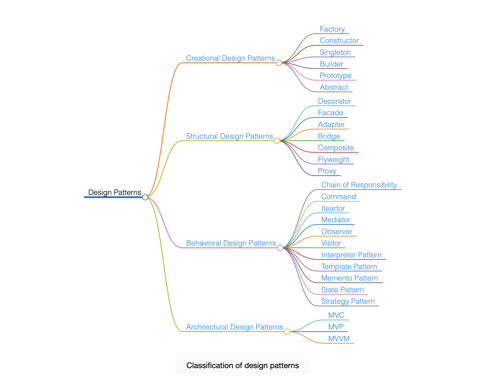

# Design Patterns

## Intro

A design pattern is a proven, reusable solution to a problem that keeps showing up in software design. It is not code you copy-paste; it is a template for how to structure classes and objects, which you adapt to your own problem.

Why use them:

- **Don't reinvent the wheel**: the problem has already been solved and tested by others.
- **Shared vocabulary**: saying "use a Factory here" tells another developer the whole idea in three words.
- **Easier change**: patterns keep code loosely coupled, so it is easier to extend and maintain (they are SOLID principles put into practice).

A pattern is a tool, not a goal. Use one only when the problem it solves actually exists in your code; forcing patterns in makes simple code complicated.

## Classification

| Category | What it deals with | Patterns |
|----------|--------------------|----------|
| **Creational** | How objects are created | Factory, Abstract Factory, Constructor, Singleton, Builder, Prototype |
| **Structural** | How classes and objects are composed into larger structures | Decorator, Facade, Adapter, Bridge, Composite, Flyweight, Proxy |
| **Behavioral** | How objects communicate and share responsibilities | Chain of Responsibility, Command, Iterator, Mediator, Observer, Visitor, Interpreter, Template, Memento, State, Strategy |
| **Architectural** | How the whole application is organised | MVC, MVP, MVVM |

The first three categories come from the "Gang of Four" (GoF) book. Architectural patterns work at a higher level: they shape the entire application rather than a few classes.
