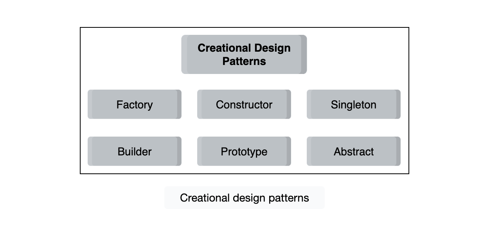

# Creational Design Patterns

## Intro

Creational patterns deal with **how objects are created**. Instead of scattering `new SomeClass(...)` all over the code, they put object creation in one controlled place.

Why this matters: when code creates objects directly, it is tied to the exact class and to the details of how that class is built. Creational patterns hide those details, so the rest of the code only asks for "an object that can do X" and does not care which class it gets or how it was put together.

## Patterns

| Pattern | In one line | Use it when |
|---------|-------------|-------------|
| **Factory** | A method decides which class to create and returns it behind a common interface. | The exact type needed is only known at runtime (e.g. create a `Car` or `Bike` based on input). |
| **Abstract Factory** | A factory that creates whole families of related objects. | Objects must be used together and match (e.g. a Mac button with a Mac checkbox, never mixed with Windows ones). |
| **Constructor** | A constructor initialises a new object with its own properties and methods. | You need many objects of the same kind with different values. |
| **Singleton** | Only one instance of a class exists, with one global access point. | Exactly one shared object is needed (e.g. config, logger, connection pool). |
| **Builder** | Builds a complex object step by step instead of through one huge constructor. | An object has many optional parts (e.g. a `Pizza` with any mix of toppings). |
| **Prototype** | Creates new objects by cloning an existing one. | Creating from scratch is expensive, or you want a copy of an already-configured object. |

## When to use

### Factory pattern

- When the type of objects required cannot be anticipated beforehand.
- When multiple objects that share similar characteristics need to be created.
- When you want to generalize the object instantiation process, since the object setup is complex in nature.

### Constructor pattern

- When you want to create multiple instances of the same template, since the instances can share methods but can still be different.
- It can be useful in the design of libraries and plugins.

### Singleton pattern

- Mostly used when we want a single object to coordinate actions across a system.
- **Services**: they store state and configuration and provide access to resources, so it makes sense to have a single instance of a service in an application.
- **Databases**: databases such as MongoDB use the Singleton pattern for database connections.
- **Configurations**: if there is an object with a specific configuration, we don't need a new instance every time that configuration object is needed.

### Builder pattern

- When building apps that require you to create complex objects. It hides the construction process of building these objects.
- A good example is a DOM, where we might need to create plenty of nodes and attributes. The construction process can get quite messy for a complex DOM object; the Builder pattern keeps it manageable.

### Prototype pattern

- To eliminate the overhead of initializing an object.
- When we want the system to be independent of how the products in it are created.
- When creating objects from a database whose values are copied to the cloned object.

### Abstract Factory pattern

- Applications requiring the reuse or sharing of objects.
- Applications with complex logic, because they have multiple families of related objects that need to be used together.
- When we require object caching.
- When the object creation process is to be shielded from the client.
