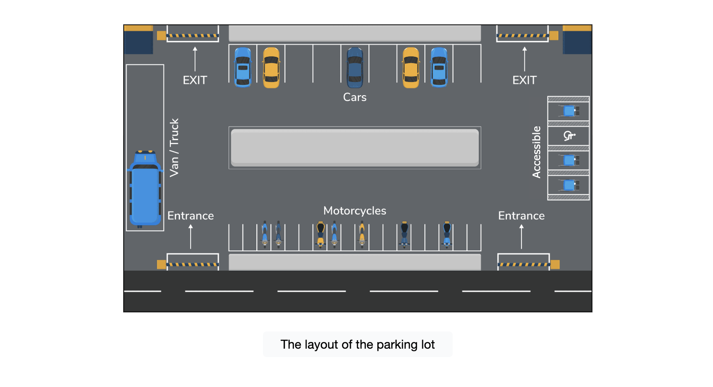

# Parking Lot

## Problem definition

A parking lot is a designated area for parking vehicles, commonly found in venues like shopping malls, sports stadiums, and office buildings.

- It has a **fixed number of parking spots**, allocated for different types of vehicles.
- Each spot is **charged based on the duration** a vehicle remains parked.
- Parking time is tracked using a **parking ticket** issued at the entrance.
- On exit, the customer pays at an **automated exit panel** or through a **parking agent**, using a **credit/debit card or cash**.

What the layout shows:

- There are **two entrances and two exits**, so several vehicles can enter and leave at the same time.
- Spots are grouped by type: **cars**, **motorcycles**, **van / truck**, and **accessible**.
- Spot sizes differ: a van / truck spot is much larger than a motorcycle spot.

## What the design must cover

1. **Vehicle types**: manage parking for car, van, truck, motorcycle, etc., across potentially multiple floors and zones.
2. **Spot types**: allocate and track spot availability by type (compact, large, accessible, motorcycle).
3. **Tickets**: issue and manage parking tickets to track entry, parking duration, and exit.
4. **Payments**: pay at automated exit panels or via human agents, with multiple payment methods (cash, card, coupon).
5. **Pricing**: pricing models may vary by hour, spot type, or vehicle type.
6. **Occupancy**: track spot occupancy in real time and keep entry/exit flows efficient during busy periods.
7. **Special cases**: accessible parking spots and overflow situations (the lot is full).

## The simplest story

Before designing for all seven points, start with one path through the system:

> A car enters, gets a ticket, parks in a free spot, exits, and pays.

Everything else is an upgrade to this story.
