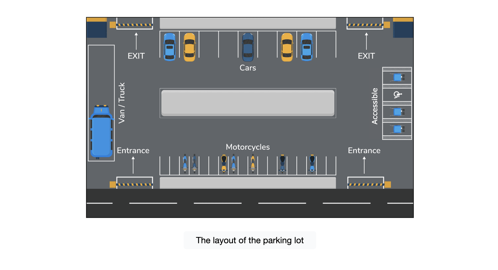

# Parking Lot

## Problem definition

A parking lot is a designated area for parking vehicles, commonly found in venues like shopping malls, sports stadiums, and office buildings.

- It has a **fixed number of parking spots**, allocated for different types of vehicles.
- Each spot is **charged based on the duration** a vehicle remains parked.
- Parking time is tracked using a **parking ticket** issued at the entrance.
- On exit, the customer pays at an **automated exit panel** or through a **parking agent**, using a **credit/debit card or cash**.



What the layout shows:

- There are **two entrances and two exits**, so several vehicles can enter and leave at the same time.
- Spots are grouped by type: **cars**, **motorcycles**, **van / truck**, and **accessible**.
- Spot sizes differ: a van / truck spot is much larger than a motorcycle spot.

## What the design must cover

1. **Vehicle types**: manage parking for car, van, truck, motorcycle, etc., across potentially multiple floors and zones.
2. **Spot types**: allocate and track spot availability by type (compact, large, accessible, motorcycle).
3. **Tickets**: issue and manage parking tickets to track entry, parking duration, and exit.
4. **Payments**: pay at automated exit panels or via human agents, with multiple payment methods (cash, card, coupon).
5. **Pricing**: pricing models may vary by hour, spot type, or vehicle type.
6. **Occupancy**: track spot occupancy in real time and keep entry/exit flows efficient during busy periods.
7. **Special cases**: accessible parking spots and overflow situations (the lot is full).

## The simplest story

Before designing for all seven points, start with one path through the system:

> A car enters, gets a ticket, parks in a free spot, exits, and pays.

Everything else is an upgrade to this story.

## Where the code stands

The simplest story runs end to end from [ParkingLotMain.java](ParkingLotMain.java): a car enters, parks in a free spot, exits, and pays by UPI.

Checked against the seven points above:

| # | Requirement | Status | What is missing |
|---|-------------|--------|-----------------|
| 1 | Vehicle types | Done | `Car`, `Bike`, `Van`, `Truck` with the `VehicleType` enum |
| 2 | Spot types | Missing | Every spot is identical, so a truck can park in what should be a bike spot |
| 3 | Tickets | Missing | Times are stored on the spot; there is no `Ticket` class |
| 4 | Payments | Done | Cash, card, and UPI through the `Payment` interface |
| 5 | Pricing | Partly | One flat rate of 20 per started hour for every vehicle |
| 6 | Occupancy | Partly | A spot knows if it is free, but there are no free-spot counts and all 100 spots are on floor 1 |
| 7 | Special cases | Partly | A full lot throws an exception; there are no accessible spots |

## Patterns used

| Pattern | Where | Why |
|---------|-------|-----|
| **Singleton** | [ParkingOperations.java](parking/ParkingOperations.java) | There is one lot, so every entrance and exit must share one list of spots. |
| **Strategy** | [Payment.java](payment/Payment.java) with `CashPayment`, `CardPayment`, `UpiPayment` | `exit` calls `payment.pay(fee)` without knowing which payment it was given. A new payment method is a new class, with no change to existing code. |
| **Facade** | [ParkingLotFacade.java](ParkingLotFacade.java) | `main` makes one call; the facade runs parking, fee calculation, and payment in the right order. |

Facade is not the same as hiding a loop inside a method (that is encapsulation). It is a Facade only because it coordinates **several other classes**.

Factory is not used yet. It would turn a `PaymentType` chosen by the customer into the right `Payment` object, which Strategy then uses:

```
PaymentType.UPI  ->  PaymentFactory.create()  ->  UpiPayment object  ->  exit() calls pay()
                     (Factory: creates it)                              (Strategy: uses it)
```

## Cases still to add

In priority order. The first three are what an interviewer expects to see.

1. **Ticket**
   - `enter` returns a `Ticket` holding the vehicle, the spot, and the entry time; `exit` takes that `Ticket`.
   - Fixes a flaw in the current code: times live on the spot, so the next vehicle in the same spot overwrites them.
2. **Spot types and matching**
   - Add a `SpotType` enum (`MOTORCYCLE`, `COMPACT`, `LARGE`) and give each `ParkingSpot` a type.
   - `entry` picks only a free spot that fits the vehicle: bike to motorcycle spot, car to compact, van and truck to large.
3. **Pricing by vehicle type**
   - Different hourly rates, for example bike 10, car 20, truck 40.
   - Put it behind a `PricingStrategy` interface, which is a second use of Strategy.
4. **Lot full**
   - Today `entry` throws `IllegalStateException("Parking lot is full")`.
   - With spot types, "full" is per type: the lot can be full for trucks while bike spots are free.
5. **Multiple floors**
   - A `Floor` class holds spots; the lot holds floors. Free-spot counts per floor and per type cover the occupancy requirement.
6. **Two vehicles entering at the same time**
   - Two gates can both see spot A1 as free before either parks, so both vehicles get A1.
   - Fix: mark `entry` and `exit` as `synchronized`, so only one gate assigns a spot at a time.
7. **Accessible spots**
   - One more value in `SpotType`, given only to vehicles that are flagged as needing it.
8. **Payment failure**
   - `pay` returns `false`; the facade throws. A real exit gate would stay closed and ask for another payment method.
9. **PaymentFactory**
   - `PaymentFactory.create(PaymentType)` so the caller passes a type, not `new UpiPayment()`.
