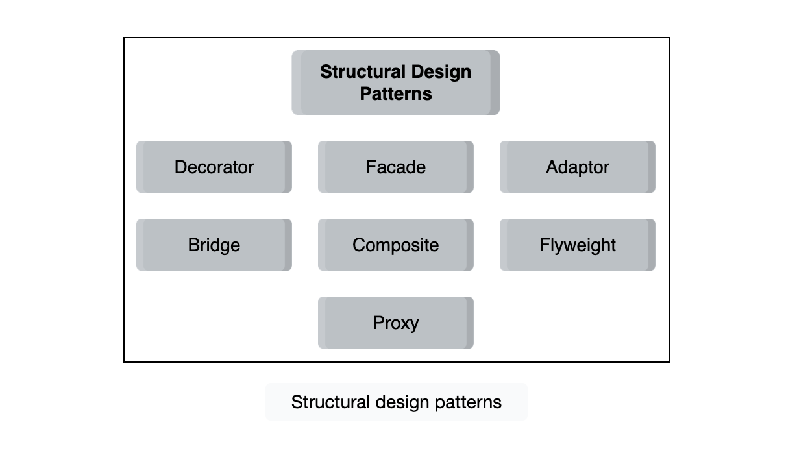

# Structural Design Patterns

## Intro

Structural patterns deal with **how classes and objects are put together** to form larger structures. They focus on relationships: how one object wraps, contains, or stands in front of another.

Why this matters: as a system grows, pieces that were not designed together have to work together. Structural patterns let you combine them, or add to them, without rewriting the existing classes.

## Patterns

| Pattern | In one line | Use it when |
|---------|-------------|-------------|
| **Decorator** | Wraps an object to add behaviour without changing its class. | You want to add features in any combination (e.g. coffee + milk + sugar) without a subclass for each mix. |
| **Facade** | One simple interface in front of a complex subsystem. | Callers need a single easy entry point (e.g. `placeOrder()` hiding payment, stock, and shipping). |
| **Adapter** | Converts one interface into another that the client expects. | Two classes should work together but their interfaces don't match (like a plug adapter). |
| **Bridge** | Separates an abstraction from its implementation so both can change independently. | Two dimensions vary (e.g. shape and colour) and you want to avoid a class for every combination. |
| **Composite** | Treats a single object and a group of objects the same way, as a tree. | The data is a part-whole hierarchy (e.g. files and folders). |
| **Flyweight** | Shares common data between many similar objects to save memory. | There are huge numbers of objects that repeat the same state (e.g. characters in a text editor). |
| **Proxy** | A stand-in object that controls access to the real one. | You need lazy loading, caching, access checks, or logging around an object. |

## Decorator

Add new behaviour to an object by wrapping it in another object with the same interface, without modifying the original class.

Full notes: [Decorator.md](Decorator.md)

## Facade

Provide one simple interface in front of a complex system, so the client does not deal with the inner workings directly.

Full notes: [Facade.md](Facade.md)

## Adapter

Make a class with an incompatible interface usable by wrapping it in a class that has the interface the client expects.

Full notes: [Adaptor.md](Adaptor.md)

## Bridge

Separate two things that vary independently into two class hierarchies, connected by a field, so each can grow without affecting the other.

Full notes: [Bridge.md](Bridge.md)
