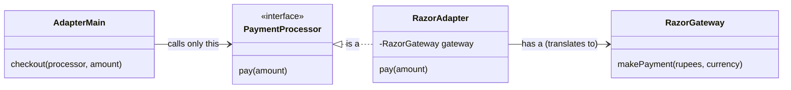

# Adapter Pattern

## Intro

Adapter makes a class with an incompatible interface usable by wrapping it in a class that has the interface the client expects.

It is a translator between two classes that cannot talk to each other. Like a travel plug adapter: the charger and the wall socket both work fine, they just don't fit, and neither one can be changed.

In simple terms: **make an existing class fit the interface your code already uses, without changing either side.**

## The problem it solves

The app pays through this interface, and all the code calls it:

```java
public interface PaymentProcessor {
    void pay(int amount);
}
```

A third-party payment library must now be used. It works, but its method has a different name and different parameters, and it cannot be edited:

```java
public class RazorGateway {

    public void makePayment(double rupees, String currency) {
        System.out.println("Razor paid " + rupees + " " + currency);
    }
}
```

The two don't fit:

```java
PaymentProcessor processor = new RazorGateway();   // compile error: not a PaymentProcessor
```

The bad options:

- Change the app to call `makePayment(...)` everywhere. Every caller is now tied to one library, and switching libraries means editing all of them again.
- Change the library. Not possible; it is not our code.

## The idea

Write one small class in the middle. It **is a** `PaymentProcessor` (what the app expects) and **has a** `RazorGateway` (the class that doesn't fit). It translates each call.

```
App  ──pay(500)──▶  RazorAdapter  ──makePayment(500.0, "INR")──▶  RazorGateway
```



## Example: payment libraries

Runnable code is in [Adapter-Code/](Adapter-Code/).

### 1. The adapter

```java
public class RazorAdapter implements PaymentProcessor {

    private final RazorGateway gateway;          // the class that does not fit

    public RazorAdapter(RazorGateway gateway) {
        this.gateway = gateway;
    }

    @Override
    public void pay(int amount) {
        gateway.makePayment(amount, "INR");      // translate the call
    }
}
```

### 2. A second library, a second adapter

Another library has yet another shape:

```java
public class PayFastGateway {

    public void send(String amountText) {
        System.out.println("PayFast sent " + amountText);
    }
}
```

```java
public class PayFastAdapter implements PaymentProcessor {

    private final PayFastGateway gateway;

    public PayFastAdapter(PayFastGateway gateway) {
        this.gateway = gateway;
    }

    @Override
    public void pay(int amount) {
        gateway.send("Rs." + amount);            // translate the call
    }
}
```

### 3. Using it

The app code is written once against `PaymentProcessor` and works with either library:

```java
PaymentProcessor razor = new RazorAdapter(new RazorGateway());
PaymentProcessor payFast = new PayFastAdapter(new PayFastGateway());

checkout(razor, 500);
checkout(payFast, 500);

static void checkout(PaymentProcessor processor, int amount) {
    processor.pay(amount);
}
```

Output:

```
Razor paid 500.0 INR
PayFast sent Rs.500
```

Neither the app's `checkout` nor the libraries were changed. Supporting a new library means writing one new adapter.

## Adapter vs Decorator vs Facade

All three hold another object inside. The difference is the interface on the outside.

| | Wraps | Interface on the outside | Purpose |
|---|-------|--------------------------|---------|
| Decorator | one object | the **same** as the inner object | add behaviour |
| Facade | many objects | a **new, simpler** one | hide complexity |
| Adapter | one object | a **different** one the client already expects | make it fit |

## Where it is used

- **`Executors.callable(runnable)`**: turns a `Runnable` into a `Callable`, so it can be used where a `Callable` is required.
- **`InputStreamReader`**: takes an `InputStream` (bytes) and makes it usable as a `Reader` (characters).
- **`Arrays.asList(array)`**: makes an array usable as a `List`.
- **Spring MVC `HandlerAdapter`**: controllers come in different shapes, and the adapters let `DispatcherServlet` call all of them the same way.
- **Your own code**: wrapping a third-party SDK (payment, SMS, storage) behind your own interface, so the rest of the app never depends on the vendor's classes.

## When to use

- You need to use an existing class whose interface does not match what your code expects.
- You cannot or should not change that class (third-party or legacy code).
- You want to be able to swap one vendor for another without touching the callers.

## Things to remember

- The adapter only translates. If it starts adding new features, it is turning into a decorator.
- Adapter is applied after the fact, to make existing things work together. It is not something to design in up front.
- One adapter per incompatible class; keep each one small.
