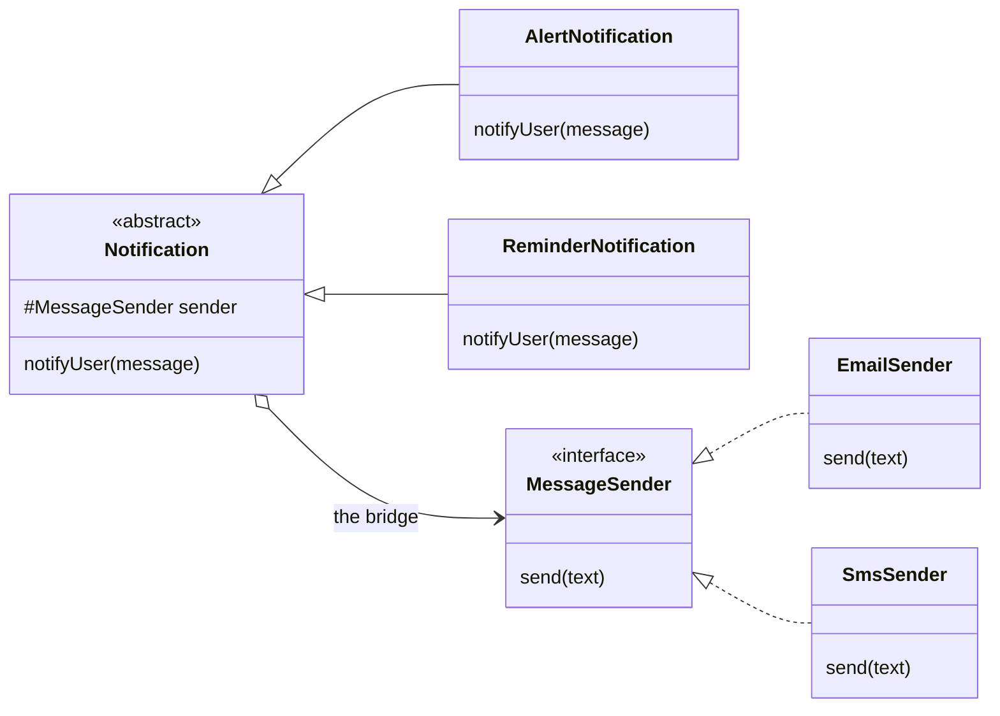

# Bridge Pattern

## Intro

Bridge separates two things that vary independently into two class hierarchies, and connects them with a field, so each can grow without affecting the other.

The "bridge" is simply that field: one object holding a reference to an object from the other hierarchy.

In simple terms: **when a class varies in two ways, don't multiply the classes. Split it into two sets and let one hold the other.**

## The problem it solves

An app sends notifications. They vary in two ways:

- **What kind** of notification: alert, reminder.
- **How** it is sent: email, SMS.

With inheritance alone, every pair needs its own class:

| | Email | SMS |
|---|-------|-----|
| **Alert** | `AlertEmailNotification` | `AlertSmsNotification` |
| **Reminder** | `ReminderEmailNotification` | `ReminderSmsNotification` |

That is 2 × 2 = 4 classes. Add a third kind (promotion) and a third channel (WhatsApp) and it is 3 × 3 = 9. The email-sending code is also repeated in every `...Email...` class.

With Bridge, the count is **kinds + channels** instead of **kinds × channels**: 2 + 2 = 4 now, 3 + 3 = 6 later, with no repetition.

## The idea

Make two separate hierarchies and let the first one hold the second:

- `Notification` (what kind): `AlertNotification`, `ReminderNotification`
- `MessageSender` (how): `EmailSender`, `SmsSender`



## Example: notifications

Runnable code is in [Bridge-Code/](Bridge-Code/).

### 1. Hierarchy 2: how it is sent

```java
public interface MessageSender {
    void send(String text);
}

public class EmailSender implements MessageSender {
    @Override
    public void send(String text) {
        System.out.println("Email: " + text);
    }
}

public class SmsSender implements MessageSender {
    @Override
    public void send(String text) {
        System.out.println("SMS: " + text);
    }
}
```

### 2. Hierarchy 1: what kind, holding a sender

```java
public abstract class Notification {

    protected final MessageSender sender;      // the bridge

    protected Notification(MessageSender sender) {
        this.sender = sender;
    }

    public abstract void notifyUser(String message);
}

public class AlertNotification extends Notification {

    public AlertNotification(MessageSender sender) {
        super(sender);
    }

    @Override
    public void notifyUser(String message) {
        sender.send("[ALERT] " + message.toUpperCase());
    }
}

public class ReminderNotification extends Notification {

    public ReminderNotification(MessageSender sender) {
        super(sender);
    }

    @Override
    public void notifyUser(String message) {
        sender.send("Reminder: " + message);
    }
}
```

`AlertNotification` decides **what** the message looks like. It has no idea **how** it is delivered; it just calls `sender.send(...)`.

### 3. Using it

Any kind can be paired with any sender when the object is created:

```java
Notification alertByEmail = new AlertNotification(new EmailSender());
Notification alertBySms = new AlertNotification(new SmsSender());
Notification reminderByEmail = new ReminderNotification(new EmailSender());
Notification reminderBySms = new ReminderNotification(new SmsSender());

alertByEmail.notifyUser("server down");
alertBySms.notifyUser("server down");
reminderByEmail.notifyUser("standup at 10");
reminderBySms.notifyUser("standup at 10");
```

Output:

```
Email: [ALERT] SERVER DOWN
SMS: [ALERT] SERVER DOWN
Email: Reminder: standup at 10
SMS: Reminder: standup at 10
```

Four combinations from four small classes, and none of them is a "combination class".

- Adding WhatsApp: one new `WhatsAppSender`. It works with every kind of notification at once.
- Adding promotions: one new `PromotionNotification`. It works with every sender at once.

## Bridge vs the others

| | Shape | Purpose |
|---|-------|---------|
| Decorator | wraps one object, same interface, wrappers can be stacked | add optional extras, any number of them |
| Adapter | wraps one object, different interface | make an existing class fit, after the fact |
| Bridge | one hierarchy holds another, exactly one from each side | keep two varying dimensions separate, designed up front |

Decorator and Bridge both avoid a class per combination. The difference: with Decorator you stack as many extras as you like on one thing (vanilla + gems + choco chips). With Bridge there are two fixed dimensions and each object has exactly one choice from each (one kind, one sender).

## Where it is used

- **JDBC**: your code uses `Connection`, `Statement` and `ResultSet` (one side), and each database supplies its own driver (the other side). You switch from MySQL to PostgreSQL by changing the driver, not your code.
- **SLF4J with Logback or Log4j**: the logging API you call is separate from the implementation that actually writes the logs.
- **Your own code**: report type (sales, inventory) × export format (PDF, Excel); payment type (one-time, subscription) × gateway.

## When to use

- A class varies in two independent ways, and you see names like `AlertEmail...`, `AlertSms...` starting to appear.
- Both sides are expected to keep growing.
- You want to choose the combination at runtime.

## Things to remember

- The bridge is just a field of the other hierarchy's interface type, passed in through the constructor.
- If only one side ever varies, this is overkill; a plain interface is enough.
- The structure looks like the Strategy pattern. The difference is intent: Strategy swaps one algorithm inside a single class; Bridge keeps two whole hierarchies growing separately.
