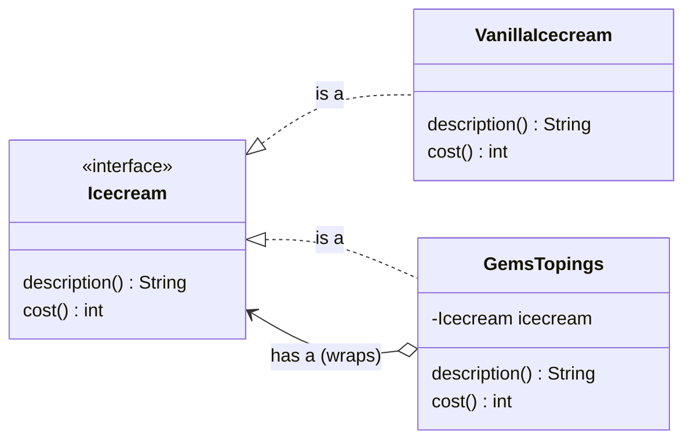

# Decorator Pattern

## Intro

Decorator adds new behaviour to an object by wrapping it in another object with the same interface, without modifying the original class.

"Decorate" simply means **wrap**. A topping does not change the ice cream underneath; it sits on top of it and adds something. The wrapper object does the same: it holds the original object inside, passes the call to it, and adds a little to the answer.

## The problem it solves

An ice cream shop sells a plain vanilla cone. Customers want toppings: gems, choco chips, or both.

With inheritance, every possible order needs its own class:

| Order | Class you must write |
|-------|----------------------|
| plain | `VanillaIcecream` |
| gems | `GemsVanillaIcecream` |
| choco chips | `ChocoChipsVanillaIcecream` |
| gems + choco chips | `GemsChocoChipsVanillaIcecream` |

Every new topping doubles the number of classes (3 toppings = 8 classes, 4 = 16), and a price change for one topping means editing every class that contains it.

With Decorator, you write **one class per topping**, and build the combinations when the order is made.

## The idea

A decorator class does two things at once:

- **It is an `Icecream`** (implements the interface), so it can be used anywhere an ice cream is expected.
- **It has an `Icecream`** inside it (the one it wraps), and builds its own answers from that one's answers.



## Example: ice cream with toppings

Runnable code is in [Decorator-Code/](Decorator-Code/).

### 1. The common interface

The questions every ice cream can answer, plain or decorated.

```java
public interface Icecream {
    String description();
    int cost();
}
```

### 2. The plain object

```java
public class VanillaIcecream implements Icecream {

    @Override
    public String description() {
        return "Plain vanilla icecream cone";
    }

    @Override
    public int cost() {
        return 10;
    }
}
```

### 3. The decorator

```java
public class GemsTopings implements Icecream {

    private final Icecream icecream;          // the ice cream this topping is on

    public GemsTopings(Icecream icecream) {
        this.icecream = icecream;
    }

    @Override
    public String description() {
        return icecream.description() + " + gems";    // ask inner, then add
    }

    @Override
    public int cost() {
        return icecream.cost() + 5;                   // ask inner, then add
    }
}
```

`GemsTopings` does not know what the ice cream costs. It asks the object inside it and adds its own 5.

### 4. Using it

```java
Icecream vanilla = new VanillaIcecream();
Icecream gemVanilla = new GemsTopings(vanilla);

System.out.println(vanilla.description() + " " + vanilla.cost());
System.out.println(gemVanilla.description() + " " + gemVanilla.cost());
```

Output:

```
Plain vanilla icecream cone 10
Plain vanilla icecream cone + gems 15
```

`VanillaIcecream` was never modified, and the original `vanilla` object still costs 10.

## Stacking decorators

Because the field type is `Icecream` (not `VanillaIcecream`), a topping can sit on a plain ice cream **or on another topping**. A second topping is one more class with the same shape:

```java
public class ChocoChips implements Icecream {

    private final Icecream icecream;

    public ChocoChips(Icecream icecream) {
        this.icecream = icecream;
    }

    @Override
    public String description() {
        return icecream.description() + " + choco chips";
    }

    @Override
    public int cost() {
        return icecream.cost() + 8;
    }
}
```

```java
Icecream order = new ChocoChips(new GemsTopings(new VanillaIcecream()));

System.out.println(order.description());   // Plain vanilla icecream cone + gems + choco chips
System.out.println(order.cost());          // 23
```

The call travels inwards through the wrappers, and the answer is built on the way back out:

```
ChocoChips.cost()  →  GemsTopings.cost()  →  VanillaIcecream.cost()
       8 +                   5 +                    10              = 23
```

```
┌─ ChocoChips (+8) ─────────────────┐
│  ┌─ GemsTopings (+5) ──────────┐  │
│  │  ┌─ VanillaIcecream (10) ┐  │  │
│  │  └───────────────────────┘  │  │
│  └─────────────────────────────┘  │
└───────────────────────────────────┘
```

## Decorator vs inheritance

| | Inheritance | Decorator |
|---|-------------|-----------|
| Adds behaviour to | the class | one object |
| Decided at | compile time | runtime |
| Combinations | one class per combination | one class per feature, combined by wrapping |
| Original class | unchanged | unchanged |

## Where it is used

- **Java I/O**: `new GZIPInputStream(new BufferedInputStream(new FileInputStream("data.gz")))`. Each wrapper is an `InputStream` that holds another `InputStream` and adds one feature (buffering, decompression).
- **Java Collections**: `Collections.synchronizedList(list)` and `Collections.unmodifiableList(list)` return a `List` that wraps your list and adds thread safety or blocks changes.
- **Spring**: `HttpServletRequestWrapper`, `ContentCachingRequestWrapper`, `ServerHttpRequestDecorator`, `TransactionAwareCacheDecorator`.
- **Spring annotations** (`@Transactional`, `@Cacheable`, `@Async`) use the same wrapping idea, but Spring generates the wrapper at runtime. That is called the Proxy pattern.
- **Your own services**: wrapping an `SmsNotifier` with a `LoggingNotifier` or a `RetryNotifier`, so logging and retry each live in one class.

## When to use

- You want to add optional features to an object in any combination.
- You cannot or should not modify the original class (Open Closed Principle).
- Subclassing would lead to a class for every combination.

## Things to remember

- The decorator and the wrapped object must share the same interface.
- The decorator's field should be the interface type, so decorators can wrap each other.
- Order of wrapping can matter (e.g. logging outside retry logs once; logging inside retry logs every attempt).
- Many small wrapper objects can make debugging harder, so use it only when the combinations are real.
