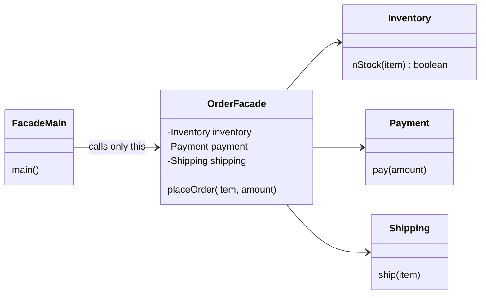

# Facade Pattern

## Intro

Facade provides one simple interface in front of a complex system, so the client does not deal with the inner workings directly.

The word "facade" means the front of a building: you see one clean face and not the rooms, wiring and plumbing behind it. In code, a facade is one class with a few easy methods that hides several classes and the steps needed to use them.

In simple terms: **one easy method in front of many messy steps.**

## The problem it solves

Placing an online order needs three classes, called in the right order:

```java
public class Inventory {
    public boolean inStock(String item) {
        System.out.println("Checking stock for " + item);
        return true;
    }
}

public class Payment {
    public void pay(int amount) {
        System.out.println("Paid " + amount);
    }
}

public class Shipping {
    public void ship(String item) {
        System.out.println("Shipped " + item);
    }
}
```

Without a facade, every caller must know all three classes and the correct sequence:

```java
Inventory inventory = new Inventory();
Payment payment = new Payment();
Shipping shipping = new Shipping();

if (inventory.inStock("Phone")) {
    payment.pay(20000);
    shipping.ship("Phone");
}
```

What goes wrong:

- The same steps are repeated in every place that places an order.
- A caller can forget the stock check, or ship before paying.
- Adding a step (e.g. sending an email) means editing every caller.

## The idea

Put the steps in one class. The client talks only to that class.



## Example: placing an order

Runnable code is in [Facade-Code/](Facade-Code/).

### 1. The facade

It holds the three classes and knows which ones are needed and in what order.

```java
public class OrderFacade {

    private final Inventory inventory = new Inventory();
    private final Payment payment = new Payment();
    private final Shipping shipping = new Shipping();

    public void placeOrder(String item, int amount) {
        if (!inventory.inStock(item)) {
            System.out.println(item + " is out of stock");
            return;
        }
        payment.pay(amount);
        shipping.ship(item);
        System.out.println("Order placed for " + item);
    }
}
```

### 2. Using it

```java
OrderFacade orderFacade = new OrderFacade();
orderFacade.placeOrder("Phone", 20000);
```

Output:

```
Checking stock for Phone
Paid 20000
Shipped Phone
Order placed for Phone
```

The client never mentions `Inventory`, `Payment` or `Shipping`. The complexity still exists, but it lives in one place.

If `inStock` returns `false`, payment and shipping are skipped, and the client code does not change at all.

## Facade vs Decorator

| | Decorator | Facade |
|---|-----------|--------|
| Wraps | one object | many objects |
| Interface | same as the wrapped object | a new, simpler one |
| Purpose | add behaviour | hide complexity |

## Where it is used

- **Spring `@Service` classes**: the controller calls `orderService.placeOrder()`, and the service talks to repositories, payment clients and other services.
- **`JdbcTemplate`**: hides opening a connection, creating a statement, looping over the result set, and closing everything.
- **SLF4J**: stands for "Simple Logging Facade for Java". One simple logging API in front of Logback, Log4j and others.

## When to use

- A task needs several classes used together in a fixed sequence.
- Many callers repeat the same setup steps.
- You want callers to depend on one class instead of the whole subsystem.

## Things to remember

- A facade does not add new behaviour; it only simplifies access to what already exists.
- The classes behind it are still usable directly when someone needs finer control.
- Keep it focused. A facade that keeps collecting unrelated methods turns into a "god class" that everything depends on.
